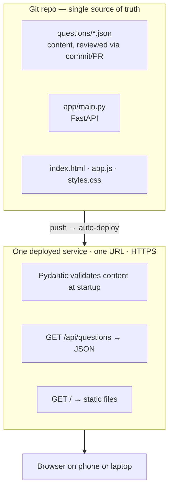

# Plan & architecture

Living document. Edit it when decisions change — a plan that disagrees with
reality is worse than no plan.

Last updated: 2026-10-16

## Goals & constraints

- **Learning goal:** the whole arc, idea → deployed. Play to Python (FastAPI).
- **Product goal:** free and publicly usable.
- **Scope discipline:** the app stays a tiny walking skeleton. Depth of the
  pipeline, not breadth of features.
- **Ship target:** mobile-friendly website. PWA later as a bounded stretch.
  No app-store app.
- **Runtime:** Python 3.14, pinned in `.python-version` so local and production
  match. (3.10 lost security support in October 2026.)

## Architecture

### Three deliberate decisions

**Content lives in git as files, not in a database.**
Questions are hand-written, LLM-drafted, and sourced from public material — all
of which need review before publishing. Git already provides diffs, history and
review. A database plus an admin UI would be a worse reimplementation of that,
with a login screen attached. Fixing a bad question is an edit and a redeploy.

**One deployable, not two.**
FastAPI serves both the API and the static files from one origin. The textbook
split (static files on a CDN, API elsewhere) means immediately dealing with
CORS. One origin avoids that entirely. Splitting later is easy.

**No database until there is a write path (phase 3).**
A read-only database rebuilt from files on every deploy teaches SQL syntax and
none of the real lessons — migrations, concurrent writes, backups, pooling.
Those arrive with attempt logging, so the database arrives then too.

## Phases

Each phase ends with something deployed and working.

### Phase 1 — "Hello, production" ✅ DONE (2026-09-20)
The minimal complete slice: the whole arc, idea to public URL.

**Live: https://sweden-quiz.onrender.com**

- [x] FastAPI app; `GET /api/questions` and `/api/health`; serves the static site
- [x] Frontend moved to `static/` so the repo root is never web-exposed
- [x] `app.js` fetches the API instead of the local file (one line changed)
- [x] Pydantic models validate every question at startup — bad content fails
      the boot instead of shipping
- [x] 13 pytest tests, covering the API and the content itself
- [x] Python 3.14, pinned
- [x] Pushed to GitHub (`grigoriev-se/sweden-quiz`)
- [x] Deployed to a public HTTPS URL, via a `render.yaml` Blueprint so the
      deploy config is in git rather than a dashboard

Validation ended up richer than planned, which is deliberate — it is the safety
net phase 2 leans on:
- `NonEmptyStr` (strips whitespace, requires content) on id, question,
  explanation and every option
- `correctIndex` must point at an option that exists
- options must be unique within a question
- ids must be unique across the set
- `category` is a `StrEnum`, so a typo cannot invent a phantom category

### Phase 2 — Content ← in progress
The actual product work, and where most of the value is.

- [x] **GitHub Actions** runs pytest on every pull request and on pushes to
      main. `main` is protected: no merge without a green `test` check, no
      force pushes, changes only through a PR. Since Render deploys `main`,
      production can only contain tested code.
- [x] **Categories are UHR's book chapters** (13, Inledning excluded), not
      invented ones. A category means *where the book teaches this*, which is
      what settles otherwise-ambiguous questions. `tests/test_models.py`
      enforces the naming convention: value = member name, lowercased, ASCII.
- [x] **`source` and `verified`.** `source` is `{section, page}`; the chapter
      is already in `category`, and the book edition is recorded once on
      `QuestionSet`. Only verified questions are served, a verified question
      must cite a source, and the app refuses to start if none are verified.
- [x] **Option order is shuffled** per question, per run, at render time.
      `state.questions` keeps the order the API sent.
- [x] Verify the placeholder questions against the book. 7 of the 8 are
      sourced and verified; the eighth (which agency handles folkbokföring)
      was removed rather than verified, because the book does not teach it.
- [ ] Split `data/questions.json` per chapter, and decide how ids are
      allocated. Cheapest now; every drafting branch otherwise edits the same
      lines and picks the same next id.
- [ ] Grow to ~50 real questions
- [ ] `localStorage` so a refresh does not wipe a run (no accounts needed)
- [ ] Add a formatter (`ruff format`) before the codebase grows

#### What `verified: true` asserts
A human checked the question, the correct answer **and the explanation**
against the cited page. Explanations stay inside what the book covers: adding
true-but-unexamined detail widens what a learner thinks is on the test, and
makes the flag mean less than it claims.

#### What goes in `source.section`
The heading **as it appears in the table of contents**, not a deeper
sub-heading. The book nests chapter -> section -> sub-heading: `category`
covers the chapter, `section` the ToC level, `page` the rest. ToC headings are
a closed set, which is what would make the cross-check below possible at all.

#### Question ids are permanent
An id is never reused; deleting a question retires it and leaves a gap in the
numbering. Phase 3 logs attempts by id, so reuse would silently merge one
question's history into another's. (q8 -> q7 was renumbered before this rule
existed; left as it is.)

#### Unknown fields are rejected
A misspelled key was the only content mistake that failed silently: Pydantic
ignored `"verfied": true`, `verified` stayed false, and the question vanished
from the quiz with nothing logged. `extra="forbid"` makes it a boot failure
naming the field. The cost is that `note` in questions.json must be declared
on the model, with `exclude=True` so it stays off the wire.

#### Duplicate questions: exact text only
`test_question_texts_are_unique` compares text lowercased with whitespace
collapsed, catching copy-paste but not rephrasing. Enough for the realistic
case, the same section drafted twice. `difflib.SequenceMatcher` at ~0.9 is the
upgrade, deferred because a threshold turns a clear failure into a judgement
call. Duplicate *ids* fail in the model instead: they break data, not content.

#### Known gap: section and category are not cross-checked
Nothing validates that `source.section` belongs to the chapter named by
`category`, so a question tagged `styre` could cite a section from `media` and
pass. Closing it needs a chapter -> sections table: real maintenance for a
mistake review catches. Revisit if mis-tagged sections actually appear.

#### Deferred: questions not from the book
The first fifty should come from the book, because that is what is examined.
When it happens: `category` shifts from "where the book teaches this" to
"topic" or becomes optional, and `source` becomes a discriminated union on a
`kind` field (`book` vs `web`). Neither needs a database. Mixing non-examined
material into one quiz also dilutes "am I ready?", so it likely belongs in an
opt-in mode rather than shuffled in.

#### Deferred: a run is the whole set
Every run serves every verified question, in file order. At ~200 that is
neither finishable nor varied, and a second run repeats the first. A run has
to become a shuffled sample of N.

**A cap without a shuffle is worse than no cap:** the first N in file order is
chapter one every time, since questions are drafted chapter by chapter. That
is why no `RUN_LENGTH` constant sits in app.js waiting to be lowered.

Already settled: `runLength()` is the only source of the count; sampling
happens in the browser, not the API, because phase 5 needs the whole library
cached offline; and the count must be clamped to what exists, so a chapter
with 8 questions cannot advertise a run of 20.

### Phase 3 — The write path
- Log anonymous attempts: question id, right/wrong. No personal data.
- Postgres, migrations, connection handling — with a real reason to exist
- Payoff: discover which questions everyone gets wrong, i.e. which to fix

### Phase 4 — Accounts (defer hard)
Only if real usage demands it. Auth, password resets, email, and GDPR
obligations the moment personal data is stored. Being account-free is a feature.

### Phase 5 — PWA
Manifest + service worker. Installable, works offline.

## Open questions

- [x] **Exam status (checked 2026-09-20).** The knowledge requirement took
      effect 6 June 2026 for applicants aged 16-66. UHR runs the test; the
      society-knowledge part was first held as a pilot in August 2026. Format:
      multiple choice, four options, one correct.
- [x] **Hosting — decided: Render**, free plan, Frankfurt region (immutable).
      Known limits: sleeps after 15 min idle and takes ~1 min to wake; 750
      instance hours/month per workspace; ephemeral filesystem (harmless —
      content is in git). Free Postgres expires 30 days after creation and is
      then deleted, so **phase 3 requires a paid database** or another provider.
      Nothing in the repo is Render-specific except `render.yaml`.
- [x] **Copyright rule.** Write original questions from factual source
      material; never transcribe UHR's own questions or prose. Facts are not
      copyrightable; their expression is.
- [ ] **Pass threshold.** Not published by UHR as of the check above. The 75%
      in `renderResult()` is a placeholder, not a decision.

## Deliberately not doing

Accounts, payments, native apps, a CMS, i18n, a front-end framework. Each stays
out until something concrete forces it in.
