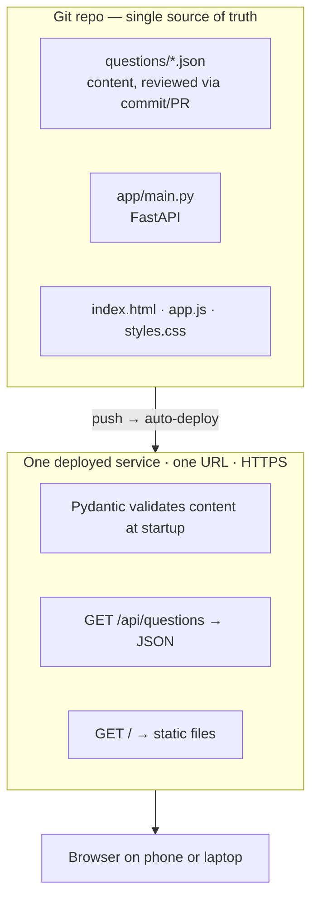

# Plan & architecture

Living document. Edit it when decisions change — a plan that disagrees with
reality is worse than no plan.

Last updated: 2026-10-16

## Goals & constraints

- **Learning goal:** the whole arc, idea → deployed. Play to Python (FastAPI).
- **Product goal:** free and publicly usable to start; keep the door open to a
  real product later.
- **Scope discipline:** the app stays a tiny walking skeleton. Depth of the
  pipeline, not breadth of features.
- **Ship target:** mobile-friendly website. PWA later as a bounded stretch.
  No app-store app.
- **Runtime:** Python 3.14, pinned in `.python-version` so local and production
  match. (3.10 lost security support in October 2026.)

## Architecture

### Three deliberate decisions

**Content lives in git as files, not in a database.**
Questions are hand-written, LLM-drafted, and sourced from public material — all
of which need review before publishing. Git already provides diffs, history and
review. A database plus an admin UI would be a worse reimplementation of that,
with a login screen attached. Fixing a bad question is an edit and a redeploy.

**One deployable, not two.**
FastAPI serves both the API and the static files from one origin. The textbook
split (static files on a CDN, API elsewhere) means immediately dealing with
CORS. One origin avoids that entirely. Splitting later is easy.

**No database until there is a write path (phase 3).**
A read-only database rebuilt from files on every deploy teaches SQL syntax and
none of the real lessons — migrations, concurrent writes, backups, pooling.
Those arrive with attempt logging, so the database arrives then too.

## Phases

Each phase ends with something deployed and working.

### Phase 1 — "Hello, production" ✅ DONE (2026-09-20)
The minimal complete slice: the whole arc, idea to public URL.

**Live: https://sweden-quiz.onrender.com**

- [x] FastAPI app; `GET /api/questions` and `/api/health`; serves the static site
- [x] Frontend moved to `static/` so the repo root is never web-exposed
- [x] `app.js` fetches the API instead of the local file (one line changed)
- [x] Pydantic models validate every question at startup — bad content fails
      the boot instead of shipping
- [x] 13 pytest tests, covering the API and the content itself
- [x] Python 3.14, pinned
- [x] Pushed to GitHub (`grigoriev-se/sweden-quiz`)
- [x] Deployed to a public HTTPS URL, via a `render.yaml` Blueprint so the
      deploy config is in git rather than a dashboard

Validation ended up richer than planned, which is deliberate — it is the safety
net phase 2 leans on:
- `NonEmptyStr` (strips whitespace, requires content) on id, question,
  explanation and every option
- `correctIndex` must point at an option that exists
- options must be unique within a question
- ids must be unique across the set
- `category` is a `StrEnum`, so a typo cannot invent a phantom category

### Phase 2 — Content ← in progress
The actual product work, and where most of the value is.

- [x] **GitHub Actions** runs pytest on every pull request and on pushes to
      main. `main` is protected: no merge without a green `test` check, no
      force pushes, changes only through a PR. Since Render deploys `main`,
      production can only contain tested code.
- [x] **Categories are UHR's book chapters** (13, Inledning excluded), not
      invented ones. A category means *where the book teaches this*, which is
      what settles otherwise-ambiguous questions. `tests/test_models.py`
      enforces the naming convention: value = member name, lowercased, ASCII.
- [ ] **`source` and `verified`** (this PR). `source` is `{section, page}`;
      the chapter is already in `category` and is not duplicated, and the book
      edition is recorded once on `QuestionSet`. `verified` defaults to false,
      only verified questions are served, and a verified question must cite a
      source. The app refuses to start if nothing is verified.
- [x] Verify the placeholder questions against the book. 7 of the 8 are
      sourced and verified; the eighth (which agency handles folkbokföring)
      was removed rather than verified, because the book does not teach it.
- [ ] Grow to ~50 real questions
- [ ] `localStorage` so a refresh does not wipe a run (no accounts needed)
- [ ] Add a formatter (`ruff format`) before the codebase grows

#### What `verified: true` asserts
Everything in the question is supported by the cited source: the question
text, the correct answer **and the explanation**. Not "someone glanced at it".

Explanations stay within what the book covers. Adding true-but-unexamined
detail quietly widens what a learner thinks is on the test, and it makes
`verified` mean less than it claims. If a fact is worth including and the book
does not cover it, it needs its own source -- see the deferred note below.

Consequence for the 8 placeholder questions: they were written from general
knowledge, not from the book, so several explanations contain detail UHR does
not mention. Verifying them means checking the explanation against the page,
not only the answer.

#### What goes in `source.section`
The heading **as it appears in the table of contents**, not a deeper
sub-heading. The book nests three levels: chapter -> section -> sub-heading.
`category` covers the chapter; `section` covers the ToC level; `page` provides
the precision below that.

Example: the fact that the Riksdag has 349 members sits under "Staten", which
sits under "Landet styrs pa olika nivaer" in the chapter "Sa har styrs
Sverige". The section is **"Landet styrs pa olika nivaer"** -- the ToC
heading -- not "Staten".

Why the ToC level: it is a closed, enumerable set, which is what would make
the cross-check below implementable one day. Sub-headings are not listed
anywhere, so there would be nothing to validate against. If the sub-heading is
ever genuinely needed, it gets its own optional field rather than overloading
this one.

#### Question ids are permanent
An id is never reused. Deleting a question retires its id, leaving a gap in
the numbering; a replacement question gets a new one.

Nothing stores ids today, so reuse is currently harmless -- the voting-age
question was renumbered q8 -> q7 before this rule existed, and the numbering
is intentionally left as it is. From here on, ids are fixed.

Why it matters from phase 3: attempt logging stores rows like "someone got q7
wrong". If an id is reused, the old question's history silently merges with
the new one's and there is no way to separate them afterwards. The same
applies to any `localStorage` memory of which questions a user has seen.

#### Unknown fields are rejected, because a typo was the one silent failure
Every other content mistake fails the boot. A misspelled key did not: Pydantic
ignores keys it does not recognise, so `"verfied": true` parsed cleanly, left
`verified` at its False default, and the question was validated, loaded and
never served -- with nothing printed anywhere. The one path by which bad
content reached production quietly was the one `verified` exists to close.

`extra="forbid"` on `Question`, `Source` and `QuestionSet` turns that into a
boot failure naming the field. It matters more as the set grows: at 7
questions a missing one is visible in the count, at 200 it is not.

The cost is that questions.json's `note` key -- its header comment, since JSON
has no comment syntax -- had to be declared rather than tolerated. It is
`exclude=True`, so it stays off the wire. Tolerating extras on `QuestionSet`
instead would also have let `"book_editon"` through, leaving every page number
without the edition it is meaningless without.

#### Duplicate questions are only caught when the text matches
`test_question_texts_are_unique` compares question text lowercased with
whitespace collapsed. That catches copy-paste and reformatting. It does not
catch rephrasing: "Hur manga ledamoter har riksdagen?" and "Hur manga
ledamoter har Sveriges riksdag?" are different strings and both pass.

Good enough for now. The realistic failure while drafting in batches is the
same question produced twice from the same section, which this catches. If
rephrased near-duplicates start appearing, `difflib.SequenceMatcher` with a
high threshold (~0.9) is the stdlib option -- deferred because a threshold
turns a clear failure into a judgement call.

Duplicate *ids* are a different matter and fail in the model, because they
break the data rather than the content.

#### Known gap: section and category are not cross-checked
`category` names the chapter; `source.section` names a sub-section inside it.
Those overlap, and nothing validates that the section actually belongs to the
chapter — a question tagged `styre` could cite "Kallkritik", which lives under
Mediernas roll, and every check would pass.

Both are kept because they serve different consumers: `category` is a
validated enum for filtering and statistics, `section` and `page` are for a
human going back to the book, and the section name survives a new edition
where page numbers do not.

Closing the gap would need a chapter -> sections table to validate against.
That is real maintenance for a mistake review is likely to catch, so it stays
open deliberately. Revisit if mis-tagged sections actually show up.

#### Deferred: questions not from the book
Worth having eventually — relevant questions the book does not cover. Not now:
with zero real questions written, the first fifty should come from the book,
because that is what is examined.

Two things would change when it happens, and neither needs a database —
questions stay in git:
- `category` would shift meaning from "where the book teaches this" to "topic",
  or become optional for non-book questions.
- `source` would become a discriminated union on a `kind` field
  (`{"kind": "book", section, page}` vs `{"kind": "web", title, url}`).
  `source` is already its own model, so that change is contained.

There is also a product question: mixing non-examined material into the same
quiz dilutes "am I ready?". Such questions probably belong in an opt-in mode
rather than shuffled in. Revisit on the first real example.

#### Deferred: a run is the whole set
Every run serves every verified question, in file order. At 7 that is the
product; at ~200 it is neither finishable nor varied, and a second run is
identical to the first. A run needs to become a shuffled sample of N.

**A cap without a shuffle is worse than no cap.** Taking the first N in file
order means taking them in the order they were drafted, and they are drafted
chapter by chapter -- so every run would be chapter one, every time, and the
rest of the book would be unreachable. The cap and the shuffle are one
change, not two. This is why there is no RUN_LENGTH constant sitting in
app.js waiting to be lowered: a seam that looks one edit away from working,
and is not, is worse than no seam.

The options need shuffling too, and sooner than it looks: `correctIndex` is 1
in five of the seven questions. Position is currently a better predictor of
the answer than knowledge is.

Three things are already settled when this is picked up:
- **`runLength()` in app.js is the only place the count comes from.** The
  progress text, both end-of-run checks and the score denominator read it.
- **Sampling happens in the browser, not the API.** Phase 5 is an offline
  PWA, which needs the whole library cached locally; a server that sampled
  (`/api/questions?limit=20`) would put a network round trip in front of
  every run and make offline practice impossible. The API keeps returning
  everything.
- **The count must be clamped to what exists.** Once questions are filtered
  by category, a chapter with 8 questions must not advertise a run of 20.

Not now, because it only has to be right by ~50 questions, and `localStorage`
(above) will want to save a run -- which is easier to design once a run is a
defined thing rather than "all of them".

### Phase 3 — The write path
- Log anonymous attempts: question id, right/wrong. No personal data.
- Postgres, migrations, connection handling — with a real reason to exist
- Payoff: discover which questions everyone gets wrong, i.e. which to fix

### Phase 4 — Accounts (defer hard)
Only if real usage demands it. Auth, password resets, email, and GDPR
obligations the moment personal data is stored. Being account-free is a feature.

### Phase 5 — PWA
Manifest + service worker. Installable, works offline.

## Open questions

- [ ] **Exam status.** Confirm the current status and format of the Swedish
      citizenship knowledge requirement via Migrationsverket / official sources.
      If the format is not final, keep phases 1–2 lean.
- [x] **Hosting — decided: Render**, free plan, Frankfurt region (immutable).
      Known limits: sleeps after 15 min idle and takes ~1 min to wake; 750
      instance hours/month per workspace; ephemeral filesystem (harmless —
      content is in git). Free Postgres expires 30 days after creation and is
      then deleted, so **phase 3 requires a paid database** or another provider.
      Nothing in the repo is Render-specific except `render.yaml`.
- [ ] **Copyright rule.** Facts are not copyrightable; the expression of a
      question is. Decide the rule now, at 8 questions, not at 200. Working
      assumption: write original questions from factual source material, never
      transcribe official sample questions verbatim.
- [ ] **Pass threshold.** Currently a placeholder 75% in `renderResult()`.

## Deliberately not doing

Accounts, payments, native apps, a CMS, i18n, a front-end framework. Each stays
out until something concrete forces it in.
